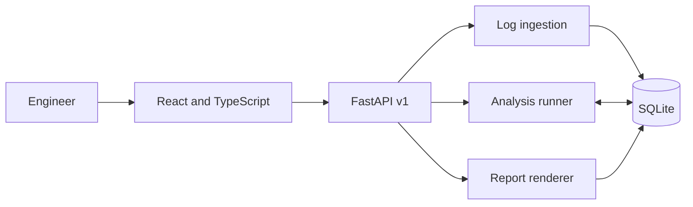
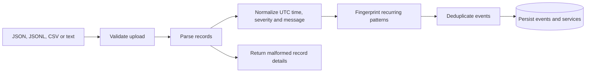
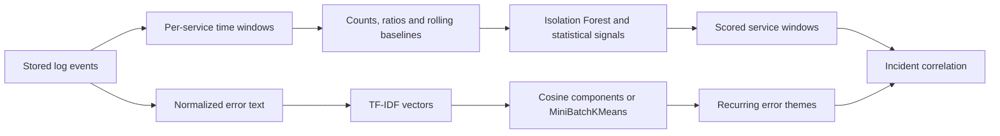
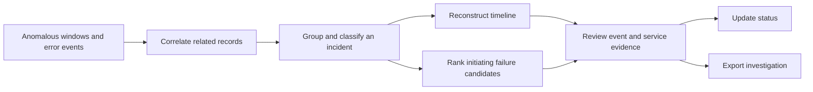
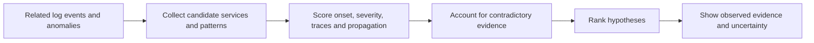

# TraceLens

TraceLens is a local investigation tool for software incidents. It ingests application logs, detects statistically unusual service behavior, groups recurring errors, and ranks possible initiating failures. Engineers can inspect the underlying events and export an investigation as Markdown or JSON.

During an outage, a downstream service may emit the largest error spike even though its dependency failed first. TraceLens puts the event sequence, shared identifiers, and statistical signals in one workspace so investigators can compare explanations and trace each conclusion back to the logs.

## Run with Docker

From the repository root, with Docker and Compose running:

```bash
docker compose up --build
```

Open **http://127.0.0.1:8080**. The browser and API use the same origin, and the backend remains on the Compose network. Swagger UI is at **http://127.0.0.1:8080/docs**. SQLite data persists in the `tracelens-db` volume across container restarts and ordinary shutdowns.

```bash
docker compose ps
docker compose logs backend
docker compose down
```

## Run for development

Use Python 3.11 or later and Node.js 22 LTS. Start the backend from the repository root.

```bash
cd backend
python -m venv .venv
source .venv/bin/activate
python -m pip install -r requirements.txt -r requirements-dev.txt
python -m uvicorn app.main:app --reload --host 127.0.0.1 --port 8000
```

In PowerShell, use the virtual environment interpreter directly.

```powershell
cd backend
py -3.11 -m venv .venv
.\.venv\Scripts\python.exe -m pip install -r requirements.txt -r requirements-dev.txt
.\.venv\Scripts\python.exe -m uvicorn app.main:app --reload --host 127.0.0.1 --port 8000
```

From the repository root in another terminal:

```bash
cd frontend
npm ci
npm run dev
```

Open **http://localhost:5173** for the application or **http://127.0.0.1:8000/docs** for Swagger UI.

| Environment variable | Example | Purpose |
| --- | --- | --- |
| `TRACELENS_DB_PATH` | `./tracelens.sqlite3` | SQLite file path. Compose supplies its own path inside the persistent volume. |
| `TRACELENS_CORS_ORIGINS` | `http://localhost:5173,http://127.0.0.1:5173` | Comma-separated allowed browser origins. |
| `TRACELENS_MAX_UPLOAD_BYTES` | `26214400` | Maximum uploaded file size in bytes, 25 MiB by default. Compose allows up to 1 MiB of additional HTTP request data for multipart encoding. |

Set values in the backend process environment for local development. For Compose, copy `.env.example` to `.env` at the repository root to override its interpolated settings.

## Try the demonstration

1. Open **Data Upload** and choose **Load demo & analyze**. The repository ships a deterministic synthetic JSONL dataset at `data/generated/demo.jsonl`.
2. After the analysis finishes, open **Incidents** and select the incident involving Database, Payment, Checkout, and API Gateway.
3. Compare the first database connection timeouts with later payment failures, checkout errors, and gateway responses. Check shared trace or request identifiers where available.
4. Review the candidate scores and evidence in the incident. The dataset is designed to make the database a plausible initiating service. The ranking is computed from observed logs without using the scenario description. On a fresh database, the bundled 5,240 records yielded 31 anomalies, eight clusters, and two incidents under default settings. The leading database hypothesis for the cascade scored 0.901.
5. Change the incident status, then export Markdown or JSON.

Run these commands from the root to regenerate the fixture, load it, and run analysis against a local backend.

```bash
python scripts/generate_sample_logs.py
python scripts/seed_database.py
python scripts/run_analysis.py
```

For either API-based script, pass `--url http://127.0.0.1:8080` when using Compose.

## Architecture



The backend uses Python, FastAPI, Pydantic, SQLAlchemy, SQLite, Pandas, NumPy, and scikit-learn. The frontend uses React, TypeScript, Vite, Tailwind CSS, Recharts, and Lucide. Docker Compose, Pytest, ESLint, TypeScript, and GitHub Actions cover execution and checks. The analysis runs locally without API credentials.

### Data processing



Upload feedback identifies skipped and duplicate records. Normalized messages replace common variable tokens so repeated failures can be counted together while stored events retain the context needed for review. See the [architecture guide](docs/ARCHITECTURE.md) for the application and storage layout.

### Machine learning



Isolation Forest uses randomly partitioned feature space. Unusual windows tend to be isolated in fewer splits, yielding higher anomaly evidence. Statistical comparisons use window activity and error signals against service baselines. Small samples use fallback behavior. TF-IDF weights terms by their prevalence within a message and rarity across the corpus. Small corpora group templates by connected components of cosine-similarity matches. Large corpora use MiniBatchKMeans, which assigns vectors to centroids and updates them in batches. Groups are useful leads for investigation and can contain several underlying failures. See the [ML pipeline](docs/ML_PIPELINE.md).

### Incident investigation



Incident detection considers severity, frequency, timing and correlation evidence. The timeline orders actual log records and relevant analysis signals. Incident state can be updated independently of the evidence.

### Root cause ranking



Ranked hypotheses compare which services showed early abnormal behavior and how their events relate to later failures. A confidence score expresses evidence under the ranking method. It is separate from the anomaly score and is not a calibrated probability of causation. See the [root cause methodology](docs/ROOT_CAUSE_METHODOLOGY.md).

## Database and API

SQLite stores imports, log events, incidents and event links, anomalies, error clusters, analysis runs, and application settings. Service summaries are computed from stored events. Hypotheses and dependency information are stored with incident or analysis records. The API reads stored results and serves the investigation UI. FastAPI publishes the request and response schemas in Swagger UI and OpenAPI.

| Resource | Operations |
| --- | --- |
| System | Health and analytics summary |
| Logs | Upload, load the demo, list and filter events, retrieve an event |
| Incidents | List and inspect incidents, change status |
| Analysis | Run analysis and list runs, anomalies, and clusters |
| Services | List services, retrieve service detail, inspect dependencies |
| Reports | Export an incident as Markdown or JSON |

All API resources use the `/api/v1` prefix. See the [API reference](docs/API_REFERENCE.md) for routes and examples.

## Tests

From the repository root, run the backend suite and frontend checks in their respective directories.

```bash
cd backend
python -m pytest
```

```bash
cd frontend
npm ci
npm run typecheck
npm run lint
npm run build
```

```bash
docker compose config --quiet
```

The GitHub workflow runs the backend and frontend checks on pushes and pull requests. Tests can use synthetic logs and temporary databases.

## Repository tour

| Directory or file | Contents |
| --- | --- |
| `backend/app/` | FastAPI routes, models, ingestion, features, ML, incident correlation and reporting |
| `backend/tests/` | Backend tests |
| `frontend/src/` | React views, API integration, reusable controls and styles |
| `data/samples/` | Small format samples for manual uploads |
| `data/generated/` | Committed deterministic demo dataset |
| `scripts/` | Demo generation and API-based utilities |
| `docs/` | Architecture, ML, API, root cause, project walkthrough and learning guide |
| `.github/workflows/ci.yml` | GitHub Actions checks |
| `docker-compose.yml` | Backend and frontend containers, health checks and persistent storage |

## Limitations and roadmap

TraceLens targets local or controlled demonstrations. The SQLite and synchronous analysis design suits bounded datasets and single-instance use. Sparse logs, clock skew, missing identifiers, and noisy text can lower evidence quality. Inferred dependencies are associations and require independent confirmation. Built-in redaction covers common patterns and cannot guarantee that arbitrary inputs are free of sensitive data.

Dataset management covers imports and import history. Per-upload deletion and retention controls are outside the current UI.

Potential extensions include instrumented OpenTelemetry ingestion for stronger dependency evidence, background jobs and incremental analysis for sustained workloads, and labeled incident replay to evaluate ranking and alert quality.

For learning and contribution, use the [project guide](docs/PROJECT_GUIDE.md), [16-module learning guide](docs/LEARNING_GUIDE.md), and [contribution guide](CONTRIBUTING.md). See the [security policy](SECURITY.md) before sharing logs or exposing an instance. Code is available under the [MIT License](LICENSE).


